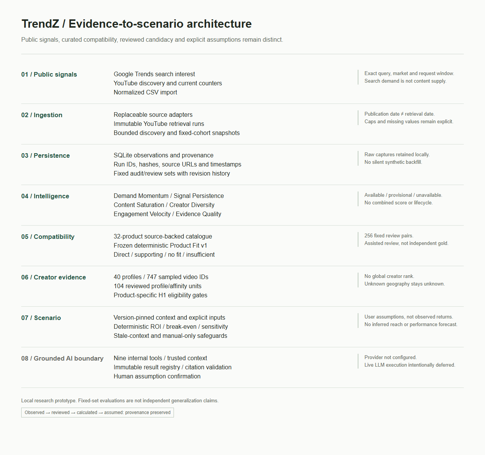

# Architecture

## Boundaries

| Stage | Responsibility | Evidence boundary |
| --- | --- | --- |
| Sources | Google Trends, YouTube, normalized CSV | Demand/search is separate from sampled publication supply |
| Ingestion | Replaceable adapters and bounded creator expansion | Credentials stay server-side; no collection on page requests |
| Persistence | SQLite observations, immutable YouTube runs, cohort snapshots | Query/market/window/run/hash and retrieval timestamps preserved |
| Intelligence | Six independent dimensions | Available/provisional/unavailable; no combined score or lifecycle |
| Product Fit | Frozen rules over a curated source-backed catalogue | Compatibility, not measured efficacy or commercial value |
| Creator evidence | Separate profile and topic review; H1 product-specific eligibility | Assisted review; no global ranking, inferred geography or endorsement |
| Campaign | Fully pinned context; explicit assumptions; Decimal economics | Deterministic outputs, not predicted performance |
| Grounded layer | Nine tools, ephemeral context, immutable results, exact citation checks | No provider, model orchestration or fake AI output |

## Provenance And Reproducibility

Observation date and retrieval timestamp are separate. Video publication dates are
not snapshot dates. Discovery includes rank/window/run identity; repeated snapshots
refer to a fixed cohort. Google request normalization scope is preserved; aliases
and independent requests are not merged. Missing values are never silently zero-filled.

Review units are fixed, with IDs, dev/evaluation assignments and revision histories.
Creator profile support is separate from topic affinity. Source/review artifacts
and analytical code have protected hashes. The candidate/campaign flow uses four
explicit policy/catalogue/review pins and additional trend/context hashes. A stale
scenario chain must be refreshed rather than silently switching evidence.

Runtime demo hosting uses a disposable SQLite backup, keeping protected captured
evidence untouched. The local watchlist is not an alerting service. Private review
databases and credentials are excluded from version control. Source-only Git clones
need the separately retained evidence assets; the demo guide states the dependency.

## Evaluation Limits

Product and creator reviews include assistance and are not independent human gold.
Fixed candidate sets do not describe all beauty creators or products. A capped
discovery window is a sample lower bound, not growth evidence. Retrieval-time
popularity does not establish expertise, audience, historical engagement or returns.
The 32 assistant fixtures evaluate deterministic infrastructure, not model quality.
Canonical citation checks are not arbitrary-language entailment or source-truth validation.

## Important Modules

`app_backend.py` serves Jinja views and APIs. `services/ingestion/`, `youtube_store.py`
and `database.py` handle collection/storage. `intelligence_service.py` and its
component/evidence modules expose dimensions. `product_fit.py` and
`product_catalogue.py` implement compatibility. `creator_candidates.py` and
`creator_candidate_policy.py` expose frozen H1. `campaign_context.py`,
`campaign_schema.py`, `campaign_scenarios.py` and `campaign_economics.py` bind and
calculate scenarios. The four `assistant_*.py` service modules are internal-only
Phase 7B infrastructure. No new analytical service was added in this audit.
